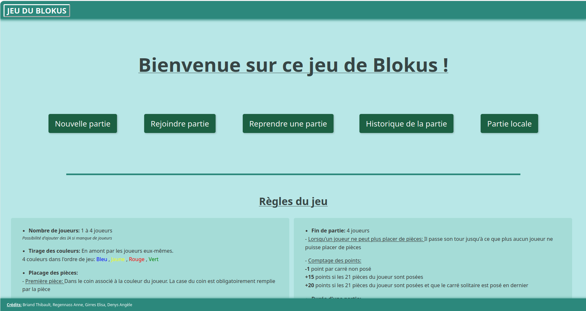
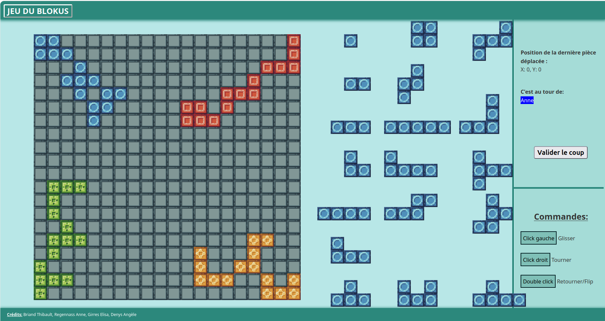

<p align="center">
  🌐 <b>Select language / Choisir la langue :</b><br>
  <a href="#lang-en"><b>🇬🇧 English</b></a> • <a href="#lang-fr"><b>🇫🇷 Français</b></a>
</p>

<a id="lang-en"></a>
# 🇬🇧 English

## Project Description

This project was developed as part of the **PPII** (Projet de Programmation Intégrative) during our engineering curriculum at **Telecom Nancy** (2024–2025). The objective was to design and build, as a team of four, a web-based version of the Blokus board game using Python and Flask.

- **Topic:** Web application development for a board game featuring artificial intelligence.
- **Goals:** Recreate the board game **Blokus** with all its rules and mechanics, supporting 1 to 4 players alongside high-performing AI opponents.
- **Tech Stack:** Monte Carlo Tree Search, Minimax Algorithm, HTML, JavaScript, CSS, SocketIO, Python

### The Team

Our group was composed of :
- **Briand Thibault** - [thibault.briand@telecomnancy.eu](mailto:thibault.briand@telecomnancy.eu)
- **Denys Angèle** - [angele.denys@telecomnancy.eu](mailto:angele.denys@telecomnancy.eu)
- **Girres Elisa** - [elisa.girres@telecomnancy.eu](mailto:elisa.girres@telecomnancy.eu)
- **Regennass Anne** - [anne.regennass@telecomnancy.eu](mailto:anne.regennass@telecomnancy.eu)

## Prerequisites

Requirements needed to run this project:

- **Langages :** Python 3.10+, HTML, JavaScript, CSS, SQLite3
- **Frameworks :** Flask 3.1.0, Flask-SocketIO 5.5.0
- **Dependencies :** See `requirements.txt`

## Installation

Comment installer le projet sur une machine locale:

### Étapes générales :

1. Create a Python virtual environment:
    ```bash
    python3 -m venv venv
    ```

2. Activate the virtual environment:
(Note: Ensure (venv) appears at the beginning of your terminal prompt)
    ```bash
    source venv/bin/activate
    ```

3. Install the required dependencies:
    ```bash
    pip install -r requirements.txt
    ```


## Exécution

*Hardware Requirement Note:* This implementation utilizes multi-core processing (`os.cpu_count()`). Having multiple CPU cores is strongly recommended for optimal performance and smoother AI decision-making. Otherwise, the game will still run, but AI thinking times may be noticeably longer. Playing a full game exclusively against AI opponents is not recommended due to heavy computation times.

1. Ensure the virtual environment is active:
    ```bash
    source venv/bin/activate
    ```

2. Start the application:

    ```bash
    python code_pages.py
    ```

3. Open your web browser and navigate to the local server address provided in your terminal.

<p align="center">
  
</p>

<p align="center">
  
</p>

<p align="right">
  <a href="#top">⬆️ <b>Back to top</b></a>
</p>

---

<a id="lang-fr"></a>
# 🇫🇷 Français

# Projet PPII - Semestre S5

---

## Description du projet

Ce projet a été développé dans le cadre du **PPII** (Projet de Programmation Intégrative) lors de notre cursus d'ingénieur à **Telecom Nancy** (2024–2025). L'objectif était de créer, en équipe de quatre personnes, une version web du jeu de société Blokus en utilisant Python et la bibliothèque Flask.

- **Sujet :** Développement d'une application web pour un jeu de société avec intelligence artificielle.
- **Objectifs :** Recréer le jeu de société Blokus avec l'ensemble de ses règles et spécificités, jouable de 1 à 4 joueurs avec la participation possible d'IA performantes.
- **Technologies utilisées :** Algorithme de Monte-Carlo, Algorithme Minimax, HTML, JavaScript, CSS, SocketIO, Python.

## Membres du groupe

Notre groupe était composé de :
- **Briand Thibault** - [thibault.briand@telecomnancy.eu](mailto:thibault.briand@telecomnancy.eu)
- **Denys Angèle** - [angele.denys@telecomnancy.eu](mailto:angele.denys@telecomnancy.eu)
- **Girres Elisa** - [elisa.girres@telecomnancy.eu](mailto:elisa.girres@telecomnancy.eu)
- **Regennass Anne** - [anne.regennass@telecomnancy.eu](mailto:anne.regennass@telecomnancy.eu)

## Prérequis

Configuration et outils nécessaires pour exécuter ce projet :

- **Langage(s) :** Python 3.10+, HTML, JavaScript, CSS, SQLite3
- **Frameworks :** Flask 3.1.0, Flask-SocketIO 5.5.0
- **Dépendances :** Voir le fichier `requirements.txt`


## Installation

Comment installer le projet sur une machine locale:

### Étapes générales :

1. Créez un environnement python:
    ```bash
    python3 -m venv venv
    ```

2. Lancez cet environnement: 
(NB: après exécution, vérifiez la présence de l'intituté `(venv)` en amont du chemin du répertoire dans lequel vous vous trouvez)
    ```bash
    source venv/bin/activate
    ```

4. Installez les dépendances:
    ```bash
    pip install -r requirements.txt
    ```

## Exécution

**Note de performance matérielle :** Avant exécution, soyez informé que cette implémentation nécessite un minimum de performances de la part de votre machine, plus précisement, il prend en compte `os.cpu_count`. Ainsi, avoir quelques processeurs est vivement conseillé pour la meilleure expérience de jeu possible. 
Autrement, le jeu tournera tout de même, seulement le temps de calcul de l'IA sera plus lente, malgré l'optimisation effectuée sur celle-ci.
De plus soyez informé que l'IA prend déjà beaucoup de temps, il n'est donc pas conseillé de faire une partie entière contre cette dernière.

1. Assurez-vous que l'environnement virtuel Python est bien activé :
    ```bash
    source venv/bin/activate
    ```

2. Lancer l'application :

    ```bash
    python code_pages.py
    ```

3. Ouvrez votre navigateur web et rendez-vous à l'adresse locale indiquée dans votre terminal.

<p align="center">
  
</p>

<p align="center">
  
</p>

<p align="right">
  <a href="#top">⬆️ <b>Retour en haut</b></a>
</p> 